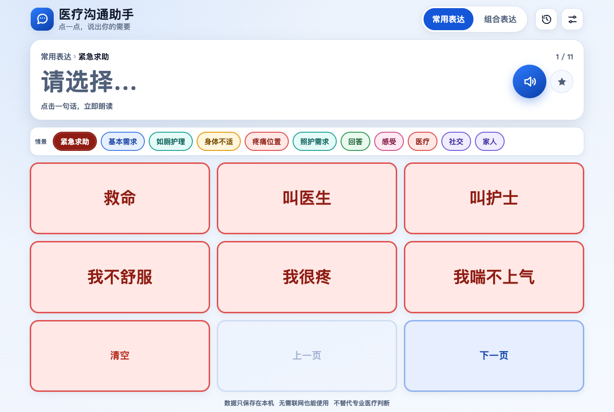
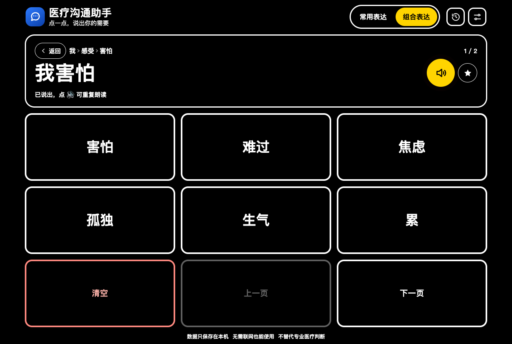
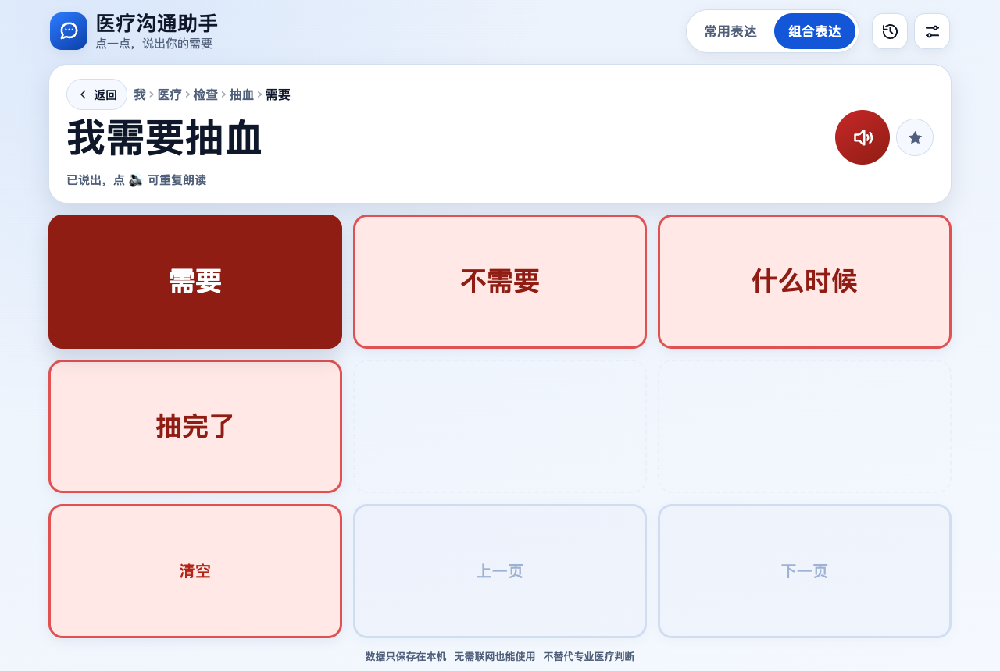
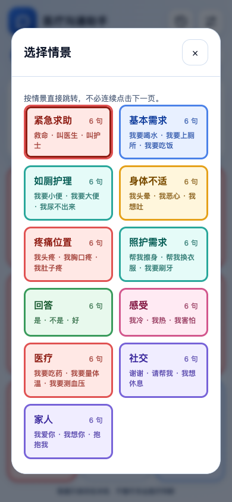

# 医疗沟通助手 · 开口说

给术后、插管或暂时无法说话的患者使用的点击式沟通网页。打开就能用，点一下词板上的按钮，句子会显示在屏幕上方并由浏览器朗读出来。

线上地址：<https://shinku-chen.github.io/taptalk/>

## 为什么做这个

术后或重症患者常常因为气管插管、声带手术或身体虚弱而暂时无法说话。写字、打字或用手势表达都比较费力，照护者也不一定总能理解。

这个项目把医院里高频出现的表达拆成 3×3 的大按钮：紧急求助、喝水、上厕所、疼痛位置、冷热、叫医生等。患者只需要认字和点击，不需要输入、不需要账号，也不依赖网络。

## 功能

### 两种表达方式

- **常用表达**：11 页、66 条完整句子，覆盖紧急求助、基本需求、如厕护理、身体不适、疼痛位置、照护、回答、感受、医疗、社交和家人。点一下直接朗读；左上角“选择情景”可以直接跳到任意情景，不必连续翻页。
- **组合表达**：按“谁 → 类别 → 具体内容 → 动作”逐步选择，能组合出更多句子。例如“我 → 医疗 → 检查 → 抽血 → 需要”会生成“我需要抽血”。

### 更完整的医院场景

- **紧急与不适**：救命、叫医生、叫护士、喘不上气、头晕、恶心、胸闷、发烧、疼痛位置。
- **基本生活**：吃饭、喝水、吃药、穿衣、换衣、洗澡、刷牙、上厕所、翻身、拍背、坐起、轮椅、拐杖、散步。
- **如厕护理**：小便、大便、尿不出来、便秘、换尿布、清洁。
- **医疗沟通**：检查、治疗、用药、护理、住院、出院；抽血、CT、核磁、X 光、超声、输液、打针、换药、量体温、测血压等。
- **身体与感受**：18 个身体部位 × 疼、很疼、有点疼、酸、麻、痒、肿、动不了；害怕、难过、焦虑、孤独、生气、累、冷、热、想家等。
- **回答与社交**：是、不是、好、不好、等一下、不知道、谢谢、请帮我、再见。

### 照顾者可以调整

- 明亮 / 深色 / 高对比三种主题。
- 标准 / 大 / 特大三档字体，按钮文字会自动缩小以避免溢出。
- 开启或关闭语音、自动朗读，调整语速（0.6–1.2），选择系统中已安装的中文语音。
- 震动反馈、屏幕常亮、全屏模式。
- “我的常用语”：最多保存 30 条患者自己的说法，可随时删除。
- 最近 30 条历史记录，可点击重播。

高对比主题示例：

### 无障碍与隐私

- 大字号、高对比、清晰焦点框，支持键盘操作：<kbd>1</kbd>–<kbd>9</kbd> 选择按钮、<kbd>Backspace</kbd> 返回/打开情景选择、<kbd>←</kbd>/<kbd>→</kbd> 翻页、<kbd>Delete</kbd> 清空、<kbd>R</kbd> 重复朗读。
- 句子区域使用 <code>aria-live</code>，屏幕阅读器可以读到当前句子。
- 不引入分析、追踪、广告或第三方脚本；词板、历史和自定义内容只保存在浏览器 <code>localStorage</code>，不上传服务器。
- 首次加载后由 Service Worker 缓存，可安装到桌面并离线使用。

## 快速开始

### 直接使用

1. 用平板或手机打开 <https://shinku-chen.github.io/taptalk/>。
2. 建议在浏览器菜单中选择“添加到主屏幕”，之后可以像 App 一样全屏打开。
3. 首次打开后保持联网加载一次，之后即使病房网络不稳定也能离线使用。

### 患者怎么用

- 着急时直接用“常用表达”，点“救命”“叫医生”“我要上厕所”等整句。
- 找其他情景时点左上角“选择情景”，可以直接跳到“吃饭”“如厕护理”“家人”等页面，不用一页页翻。
- 需要更具体的表达时切到“组合表达”，按屏幕提示一步步点。
- 点错了按“返回”退一步；点“清空”重新开始；点 🔊 重复朗读。
- 点句子右侧的星标，可以把当前句子加入“我的常用语”，以后在“选择情景”里直接点“我的常用语”。

### 照顾者怎么设置

1. 点右上角“设置”。
2. 根据患者视力调整主题和字体；根据环境调整语速或关闭自动朗读。
3. 在“我的常用语”里补充患者习惯的说法，例如“把床摇高一点”“我想听广播”。
4. 如果设备支持，可以打开“保持屏幕常亮”；iOS 不支持时按钮会置灰。

## 本地运行

项目是纯静态网页，没有构建步骤，也没有运行时依赖。

~~~bash
git clone git@github.com:Shinku-Chen/taptalk.git
cd taptalk
python3 -m http.server 8080
~~~

然后打开 <http://localhost:8080/>。

也可以直接双击 <code>index.html</code> 使用核心功能；Service Worker、安装到桌面等 PWA 能力需要通过 <code>http://</code> 或 <code>https://</code> 访问。

## 测试

~~~bash
npm test
# 等价于
node --test
~~~

测试会校验词板数据完整性、常用语分页、组合句子生成、所有人物 × 类别 × 项目 × 动作组合不会出现“我要要”“我不不”“undefined”之类的异常文本，以及静态资源版本号是否同步。

浏览器端建议至少手动走一遍：

- 常用表达翻页、朗读、历史记录。
- 组合表达四层选择、返回、清空。
- 设置修改后刷新页面仍保留。
- 手机窄屏下按钮文字不溢出、页面不横向滚动。
- 首次加载后断网刷新仍能打开。

## 修改词板

词板数据集中在 <code>js/data.js</code>，不需要改 UI 代码。新增一个项目的最小例子：

~~~js
item('水', [
    want('喝'),
    not('不喝', '喝'),
    done('喝好了'),
    request('帮我倒', '倒'),
    question('喝')
])
~~~

动作句式由 <code>js/core.js</code> 统一生成，目前已覆盖：

| 句式 | 例子 |
| --- | --- |
| <code>want</code> | 我要喝水 |
| <code>not</code> | 我不喝水 |
| <code>need</code> / <code>noNeed</code> | 我需要抽血 / 我不需要抽血 |
| <code>request</code> | 帮我倒水 / 请护士帮我倒水 |
| <code>state</code> | 我头疼 / 我头很疼 |
| <code>subjectState</code> | 灯太亮 / 空调太冷 |
| <code>done</code> | 我吃好了 |
| <code>question</code> | 我什么时候吃药？ |
| <code>where</code> | 我的轮椅在哪里？ |
| <code>direct</code> | 帮我翻身 |

直接说出、不需要再选动作的项目用 <code>say</code>：

~~~js
say('害怕')                 // 我害怕
say('休息', '{p}想{i}')     // 我想休息
~~~

新增或修改数据后运行 <code>npm test</code>。如果改了静态资源，记得同时提升 <code>index.html</code> 的资源版本参数、<code>sw.js</code> 的 <code>CACHE_VERSION</code> / <code>APP_SHELL</code> 和 <code>js/app.js</code> 的 <code>SERVICE_WORKER_URL</code>，否则已经安装过的设备可能继续使用旧缓存。

## 目录结构

~~~text
index.html              页面结构、设置/历史/帮助对话框
css/app.css             布局、主题、高对比、响应式与动效
js/data.js              词板数据（常用语、人物、类别、项目、动作）
js/core.js              纯逻辑：分页、层级解析、句子生成、数据校验
js/app.js               交互、语音、存储、设置、键盘与 PWA 注册
tests/                  Node 内置测试（词板逻辑 + 资源版本一致性）
assets/                 PWA 图标
manifest.webmanifest    安装到桌面所需的 Web App Manifest
sw.js                   离线缓存
doc/                    设计文档、历史探索与界面截图
scripts/                图标生成脚本
~~~

## 部署

仓库使用 GitHub Pages 从 <code>master</code> 分支根目录发布。推送到 <code>master</code> 后，Pages 会自动更新 <https://shinku-chen.github.io/taptalk/>。

如果部署到其它静态服务器，保持目录结构不变即可；不需要 Node 服务端。

## 设计文档

- [需求文档](doc/需求文档.md)：最初的需求、交互约定与当前实现范围。
- [APP 原型设计](doc/APP原型设计.md)：九宫格、字号、颜色和交互流程。
- [数据结构说明](doc/数据结构说明.md)：早期数据结构方案。
- [语句逻辑优化报告](doc/语句逻辑优化报告.md)：句子拼接规则的历史分析。
- [多层级扩展示例](doc/多层级扩展示例.md) / [无限层级扩展示例](doc/无限层级扩展示例.md)：词板扩展思路。

> <code>doc/</code> 中的部分文档是早期探索记录，描述的 <code>AppConfig</code> / <code>DataManager</code> 方案并未全部落地。当前实现以根目录 <code>README.md</code>、<code>AGENTS.md</code>、<code>js/data.js</code> 和 <code>js/core.js</code> 为准。

## 已知限制

- 语音由浏览器合成，应用不会上传句子内容；音色和可用语言取决于设备，没有中文语音包时可能只读英文或没有声音。
- 目前是网页/PWA，没有原生 Android 或 iOS 安装包。
- 历史记录和自定义常用语只存在当前浏览器，不跨设备同步。
- 这是沟通辅助工具，不替代医护判断。紧急情况请优先按呼叫铃或让身边的人呼叫医护人员。

## 后续可以做的事

- 图片/表情符号词板，帮助识字困难或认知障碍患者。
- 照顾者可视化编辑器，直接增删词板并导出/导入配置。
- 多语言词板与双语朗读。
- 原生 Android / iOS 封装，接入系统 TTS 和硬件按键。
- 设备间加密同步（需要先设计隐私和权限边界）。

## 参与

欢迎提 issue 或 PR，尤其是真实的医院沟通场景、词板内容和无障碍改进。提交前请先跑 <code>npm test</code>，并尽量保持词板数据与句子逻辑分离。
